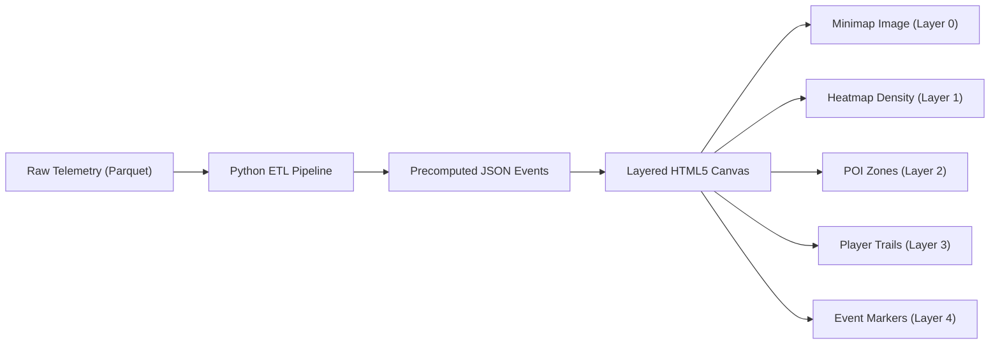

# LILA BLACK — Player Journey Visualizer: User Manual & Parameter Dictionary

A comprehensive reference manual for Level Designers, Game Designers, and Data Analysts to inspect, interpret, and extract actionable insights from player journeys on LILA BLACK maps.

---

## Table of Contents
1. [Tool Purpose & Architecture Overview](#1-tool-purpose--architecture-overview)
2. [Interface Layout & Controls Walkthrough](#2-interface-layout--controls-walkthrough)
3. [Parameter & Metric Dictionary](#3-parameter--metric-dictionary)
   - [3.1 Lobby & Match Metadata](#31-lobby--match-metadata)
   - [3.2 Combat & Casualty Metrics](#32-combat--casualty-metrics)
   - [3.3 Spatial & Journey Telemetry](#33-spatial--journey-telemetry)
   - [3.4 Heatmap Modes](#34-heatmap-modes)
4. [Deep Dive: Resolving the Kills vs. Deaths Equation](#4-deep-dive-resolving-the-kills-vs-deaths-equation)
   - [The Core Distinction: Attacker Action vs. Victim Outcome](#the-core-distinction-attacker-action-vs-victim-outcome)
   - [Why Can Deaths Be Lower Than Kills? (Deaths < Kills)](#why-can-deaths-be-lower-than-kills-deaths--kills)
   - [Case Study: Ambrose Valley Featured Match](#case-study-ambrose-valley-featured-match)
5. [The Level Designer's Playbook: How to Check Everything with Meaning](#5-the-level-designers-playbook-how-to-check-everything-with-meaning)

---

## 1. Tool Purpose & Architecture Overview

The **LILA BLACK Player Journey Visualizer** maps raw gameplay telemetry onto high-resolution $1024 \times 1024$ game minimaps. It reconstructs every participant's route, combat engagement, looting action, and point-of-interest (POI) interaction across matches.



### Why This Tool Matters for Level Design:
* **Chokepoint Validation:** Identifies whether routes funnel players toward intended combat encounters or allow unintended bypasses.
* **Combat Balance:** Distinguishes genuine Player-vs-Player (PvP) conflicts from bot-farming routes.
* **Perimeter & Hazard Safety:** Highlights lethal hazard zones where players become trapped by map geography or closing safe zones.
* **POI Pacing:** Evaluates whether designated Points of Interest attract sustained dwell time or are neglected by players.

---

## 2. Interface Layout & Controls Walkthrough

```
┌────────────────────────────────────────────────────────────────────────┐
│ 1. TOP HEADER: Map Selector | Date Selector | Match ID | Share Link    │
├──────────────────────────────┬──────────────────────────┬──────────────┤
│ 2. MATCH & COMBAT STATS      │ 4. INTERACTIVE MINIMAP   │ 6. LEGEND    │
│    • Lobby composition       │    • Pan (Drag)          │    • Color   │
│    • Kills breakdown         │    • Zoom (Scroll wheel) │      code    │
│    • Deaths breakdown        │    • Hover Tooltips      │      chips   │
│    • Duration & Loots        │    • Combat Shockwaves   │              │
├──────────────────────────────┤                          ├──────────────┤
│ 3. LAYER CONTROLS            │                          │ 7. POI       │
│    • Trails (Human / Bot)    │                          │    ANALYTICS │
│    • Combat Event Filters    │                          │    DRAWER    │
│    • Heatmap Modes           │                          │    (Collaps- │
│    • Camping Spot Halos      │                          │     ible)    │
├──────────────────────────────┴──────────────────────────┴──────────────┤
│ 5. TIMELINE CONTROLS: Scrubber Bar | Play/Pause | Speed | Event Pins  │
└────────────────────────────────────────────────────────────────────────┘
```

1. **Top Header:** 
   * Filter by map (`AmbroseValley`, `GrandRift`, `Lockdown`), date (`February_10` to `February_14`), and individual match ID.
   * Selecting **"All Matches"** switches the visualizer into macro-aggregate mode to view heatmaps and combined density across the entire day.
   * **Share View Button:** Generates a persistent URL with query parameters (`?map=...&match=...&t=...`) to share exact moments with team members.

2. **Match Info & Combat Analytics (Top-Left):**
   * Real-time breakdown of participants, combat eliminations, and casualties.

3. **Layer Controls (Bottom-Left):**
   * Independent visibility toggles for movement trails, event markers, sub-filters, and camping halos. Positioned at `bottom-3` to avoid viewport collisions.

4. **Minimap Canvas (Center):**
   * High-performance 4-layer stacked canvas rendering with 60fps path interpolation, dynamic combat shockwaves, and distance-based hover inspection.

5. **Timeline Controller (Bottom):**
   * Scrub through the match second-by-second. Jump directly to combat moments using colored bookmark pins on the track.

6. **Legend (Top-Right):**
   * Context-sensitive visual key reflecting the currently active layers.

7. **POI Drawer (Right Sidebar):**
   * Deep-dive statistical analysis of each named zone: traffic volume, combat density, dwell durations, and average loot collected.

---

## 3. Parameter & Metric Dictionary

### 3.1 Lobby & Match Metadata

| Parameter | Short Definition | Detailed Explanation |
| :--- | :--- | :--- |
| **`matchId`** | Unique match UUID | Unique identifier of the match instance on the Nakama game server. Suffixes like `.nakama-0` are stripped for clean presentation. |
| **`humanCount`** | Number of real players | Count of participants whose `userId` is a standard UUID with dashes (e.g., `b2365f20-...`). Indicates human level of engagement. |
| **`botCount`** | Number of server bots | Count of AI-driven bots in the match, identified by numeric strings (e.g., `1432`, `1481`). Bots follow scripted patrol and engagement behaviors. |
| **`durationSeconds`** | Total elapsed match time | Time in seconds from match start ($t=0\text{ s}$) until the final participant extracts, dies, or disconnects. |
| **`totalEvents`** | Cumulative action count | Total number of recorded telemetry packets emitted during the match (movement pings, weapon fires, loot pickups, deaths). |

---

### 3.2 Combat & Casualty Metrics

> [!IMPORTANT]
> The visualizer distinguishes between **Kills** (offensive credits awarded to an attacker) and **Deaths** (fatal casualties sustained by a victim).

| Parameter | Short Definition | Detailed Explanation |
| :--- | :--- | :--- |
| **`Total Kills`** | Sum of all kill credits awarded | Total number of lethal elimination events (`Kill` and `BotKill`) recorded across all match participants. Can exceed total deaths when kills are shared. |
| **`Kills by Human`** | Kills scored by real players | Eliminations where the killer entity was a human (`isHuman === true`). A key indicator of player performance and engagement. |
| **`Kills by Bot`** | Kills scored by AI bots | Eliminations where an AI bot delivered fatal damage to another player or bot (`isHuman === false`). |
| **`Shared Kills / Assists`** | Multi-credited team eliminations | Combat engagements where two or more participants landed lethal or near-simultaneous damage within a $\le 3.5\text{ s}$ window on the same target. Both receive a kill event in telemetry. |
| **`Total Deaths`** | Count of eliminated entities | Total unique participants who sustained fatal damage and were removed from the match. Reflects true casualties ($11 \text{ dead} \implies 11 \text{ deaths}$). |
| **`Killed by Human`** | Victims eliminated by human fire | Casualty events where spatial and temporal correlation links the death directly to a human player's confirmed kill action. |
| **`Killed by Bot`** | Victims eliminated by AI fire | Casualty events resulting from bot-vs-bot or bot-vs-human combat without decisive human participation. |
| **`Killed by Storm`** | Environmental barrier casualties | Casualties caused by the closing zone/storm boundary rather than weapon damage. Lacks an attacker coordinate. |
| **`Loots`** | Chest or item pickups | Frequency and locations of resource gathering events (`Loot`). Used to measure loot POI efficiency and player economy routes. |

---

### 3.3 Spatial & Journey Telemetry

| Parameter | Short Definition | Detailed Explanation |
| :--- | :--- | :--- |
| **`Positions` / `BotPositions`** | World $(X, Z)$ coordinate pings | Periodic spatial samples (sampled every $5\text{ s}$) recorded in engine world space. Transformed at ETL into normalized $1024 \times 1024$ minimap pixel coordinates. |
| **`Human Trail`** | Continuous solid cyan path | Represents the movement journey of a human player. Solid line with heading arrows showing direction of travel. |
| **`Bot Trail`** | Dashed white/slate path | Represents an AI bot's movement path. Rendered with dashes to visually distinguish bot traffic from human routes. |
| **`Heading`** | Directional arrow vector | Arrow indicating the player's instantaneous orientation, calculated from consecutive trajectory points ($\Delta X, \Delta Y$). |
| **`Camping Spot / Dwell Cluster`** | Static position held $>15\text{ s}$ | Concentric amber aura indicating an area where a player remained within a $16\text{-pixel}$ radius for longer than $15\text{ s}$. Highlights defensive holdouts, ambush perches, or inventory management spots. |
| **`POI Zone`** | Bounding box of a named location | Defined geometric boundaries ($[X_{\min}, Y_{\min}, X_{\max}, Y_{\max}]$) enclosing key map structures (e.g., Abandoned Depot, Central Research, Radar Station). |

---

### 3.4 Heatmap Modes

| Mode | Visual Representation | Level Design Purpose |
| :--- | :--- | :--- |
| **`Traffic`** | Blue $\rightarrow$ Cyan $\rightarrow$ Green $\rightarrow$ Yellow $\rightarrow$ Red | Reveals primary travel corridors, popular rotation paths, and untouched dead zones across the map. |
| **`Kills`** | Dark Red $\rightarrow$ Bright Red $\rightarrow$ Yellow | Heatmap generated exclusively at the **attacker's position**. Pinpoints dominant firing perches, sniper nests, and high-ground advantage areas. |
| **`Deaths`** | Dark Purple $\rightarrow$ Magenta $\rightarrow$ Peach | Heatmap generated exclusively at the **victim's fallen position**. Identifies lethal kill boxes, exposed open fields, and dangerous chokepoints. |
| **`Loot`** | Forest Green $\rightarrow$ Lime $\rightarrow$ Bright Yellow | Visualizes resource distribution and confirms whether high-tier loot zones actually concentrate player attention. |

---

## 4. Deep Dive: Resolving the Kills vs. Deaths Equation

A common source of confusion in game telemetry is seeing **15 Kills** alongside **11 Deaths** in a match where no respawns exist.

### The Core Distinction: Attacker Action vs. Victim Outcome

```
       ATTACKER PERSPECTIVE                 VICTIM PERSPECTIVE
   ┌───────────────────────────┐        ┌─────────────────────────┐
   │        KILL EVENT         │        │       DEATH EVENT       │
   │  • Belongs to the shooter │        │  • Belongs to the fallen│
   │  • Placed at firing perch │        │  • Placed at body drop  │
   │  • Rewards score / credit │        │  • Ends player's match  │
   └─────────────┬─────────────┘        └────────────┬────────────┘
                 │                                   │
                 └───────────────► ◄─────────────────┘
                              DUEL / COMBAT
```

* **Kill** is an active, transitive score event awarded to any player who inflicts fatal damage.
* **Death** is a state transition event representing the permanent elimination of a character.

---

### Why Can Deaths Be Lower Than Kills? ($Deaths < Kills$)

In modern multiplayer games with squad mechanics, assist systems, or AI combat trees, **multiple players can receive kill credit for a single eliminated target**.

$$\text{Deaths} < \text{Kills} \iff \text{Shared / Assisted Kills occurred}$$

```
                ┌──► Shooter 1 (Human) ──► Awarded "Kill" (+1)
 Target Enemy ──┤
 (1 Dead Body)  └──► Shooter 2 (Bot)   ──► Awarded "Kill" (+1)
─────────────────────────────────────────────────────────────────
 Outcome: 1 Death on the ground  |  2 Kills on the scoreboard
```

### The Three Telemetry Relationships:
1. **$Deaths < Kills$ (This Match):** Teammates or nearby combatants co-damaged targets within a rapid window ($\le 3.5\text{ s}$), generating duplicate kill rewards.
2. **$Deaths > Kills$:** Players died from non-player environmental hazards (such as the Storm boundary, falling, or self-inflicted damage) where no killer exists.
3. **$Deaths = Kills$:** Every single fight was an isolated, unassisted 1-on-1 duel with zero environmental deaths.

---

### Case Study: Ambrose Valley Featured Match

Match ID: `b971c686-07f6-4378-ad00-71b0b610414e`

```
┌────────────────────────────────────────────────────────┐
│ TOTAL LOBBY PARTICIPANTS: 15 (1 Human + 14 Bots)       │
├────────────────────────────────────────────────────────┤
│ SURVIVORS:  4 (Human + 3 Bots survived to extraction)  │
│ CASUALTIES: 11 Unique Entities Died (15 - 4 = 11)      │
├────────────────────────────────────────────────────────┤
│ KILLS LOGGED:                                          │
│   • Human Kills:       4                               │
│   • Bot Kills:        11                               │
│   • Total Kills:      15                               │
│                                                        │
│ CASUALTIES ATTRIBUTED:                                 │
│   • Killed by Human:   4 (Human's 4 targets)           │
│   • Killed by Bot:     7 (Bot vs Bot eliminations)     │
│   • Killed by Storm:   0                               │
│   • Total Deaths:     11 (4 + 7 = 11)                  │
│                                                        │
│ MATHEMATICAL DISCREPANCY:                              │
│   15 Kills - 11 Deaths = 4 Shared Assist Credits       │
└────────────────────────────────────────────────────────┘
```

> [!NOTE]
> The 4 "extra" kills represent instances where both a bot and the human player engaged the same victim during the engagement, and Nakama server scripts issued kill tokens to both contributors.

---

## 5. The Level Designer's Playbook: How to Check Everything with Meaning

Use this step-by-step checklist when auditing map balance:

### Step 1: Compare Firing Perches vs. Kill Boxes
1. Toggle **Heatmap $\rightarrow$ Kills**; observe where red clusters form. These are the **predator positions** (elevated perches, ridgelines, defensive buildings).
2. Toggle **Heatmap $\rightarrow$ Deaths**; observe where purple clusters form. These are the **kill boxes** (open valleys, choke doorways, bottleneck bridges).
3. **Design Question:** Is the distance between the kill zone and death zone fair? If deaths cluster 200m away in an open field without natural cover, add intermediate boulders, trenches, or vegetation.

### Step 2: Audit Human vs. Bot Dynamics
1. Select the human player trail (Cyan solid line).
2. Follow their trajectory using the **Timeline Slider**.
3. **Design Question:** Did the human player ever encounter another human, or did they spend 100% of their playtime eliminating bots? If humans never meet, adjust spawn point spacing or add high-value dynamic loot drops that draw humans toward the map center.

### Step 3: Inspect Camping & Ambush Behavior
1. Check the **"Camping (>15s)"** layer control.
2. Look for amber circular rings along primary transit paths.
3. Hover over each ring to check dwell duration and player ID.
4. **Design Question:** Are players camping because of rewarding tactical sightlines, or are they getting stuck navigating awkward collision geometry?

### Step 4: Examine Storm Boundary Fatalities
1. Turn on **Storm Deaths (⚡)** and turn off other layers.
2. Look at map peripheries (e.g., northwest/southwest valleys of Ambrose Valley).
3. **Design Question:** If storm deaths systematically cluster along one edge, that quadrant lacks fast rotation routes. Consider placing ziplines, jump pads, or vehicle spawns along that outer rim.

### Step 5: Verify POI Economic Efficiency
1. Open the **POI Analytics Drawer** on the right.
2. Compare **Traffic Share (%)** against **Loot Collected**.
3. **Design Question:** If a POI like *Grand Rift - Burnt Zone* has $2\%$ traffic despite having $20\%$ of the map's area, its loot density is insufficient to justify player risk. Boost reward density or place extraction beacons nearby.

---

*Document maintained as part of the LILA BLACK Level Design Toolsuite.*
